# Screens designed during the build: please review

These screens were designed during the build because there was no mockup for them, as agreed ("design as you build, make note of them once you're done and ask for feedback"). Screenshots come from the real app in Edge at your laptop size (1920×1200). Regenerate them with `node design/scene/shoot-{app,flows,tv}.mjs` while the dev server runs.

## Rolls
| Screen | Shot | What I decided |
|---|---|---|
| Spell attack | 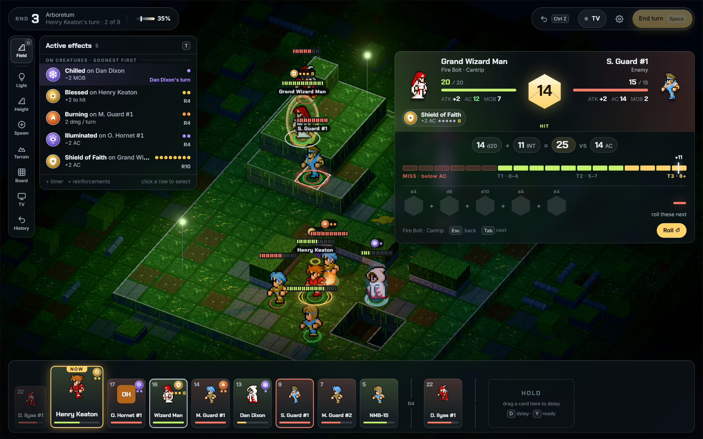 | Same panel as a weapon attack. The caster's plate names the spell ("Fire Bolt · Cantrip"), and the formula reads d20 + INT vs AC. |
| Save spell | 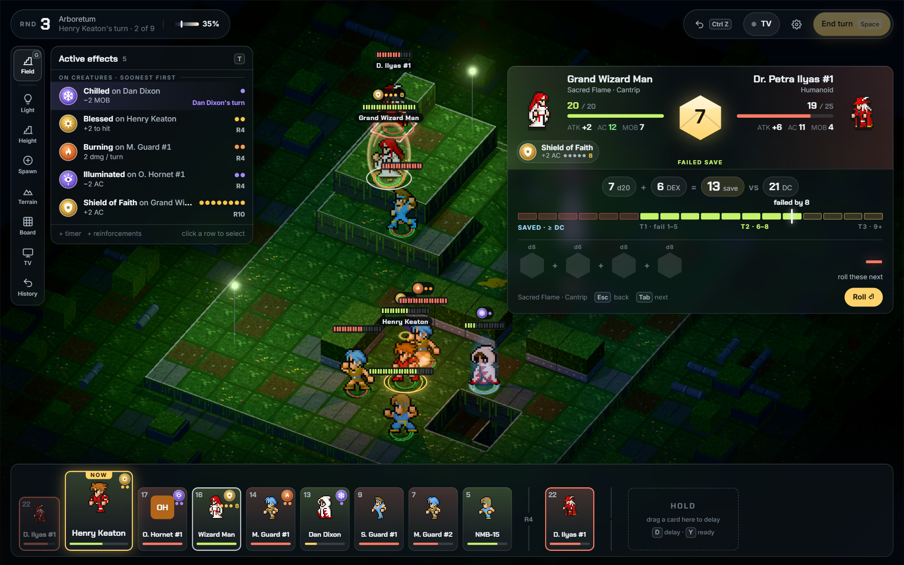 | The meter flips: SAVED is on the left and the fail tiers are on the right. The banner reads FAILED SAVE / SAVED. |
| Area spell | 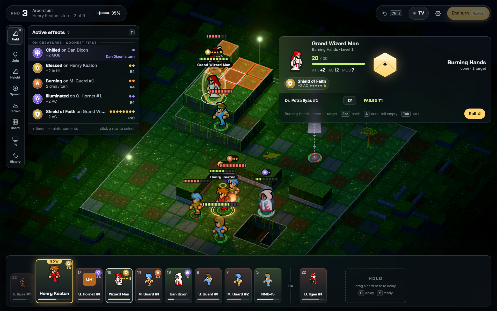 | One row per creature caught, each with its own d20 and result tag. **A** auto-rolls the empty rows; Tab moves between rows. |
| Cast picker | 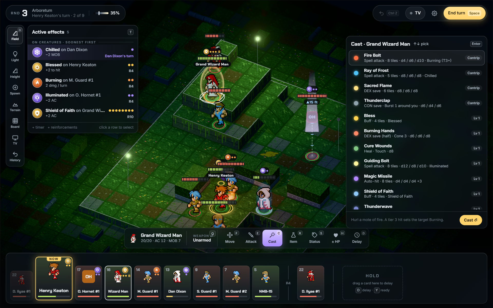 | A sheet on the right with the spell list (↑↓), slot level buttons and Cast ⏎. |
| Initiative entry | 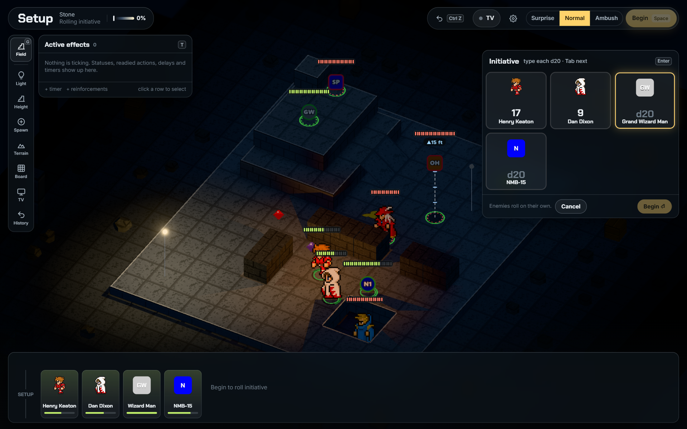 | One card per party member. You type the d20, it auto-advances, and Enter begins the battle. Enemies roll themselves. |
| Initiative tie | 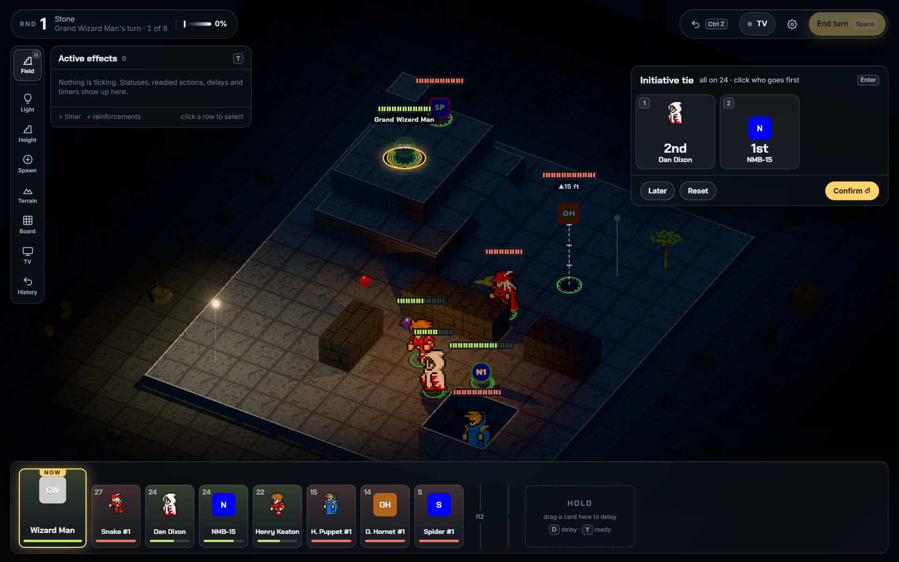 | Click the cards (or press 1–9) in turn order. The last one fills in automatically. **Later** (Esc) keeps the rolled order, but the tie comes back next round; that's an engine rule carried over from the Java app. |

## Acting on a creature
| Screen | Shot | What I decided |
|---|---|---|
| ±HP popover (H) | 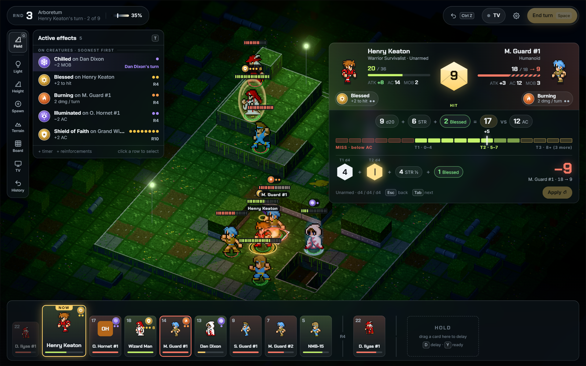 | Type the number, **+** or **−** picks heal or damage, Enter applies. Quick buttons for common amounts. |
| Status palette (S) | 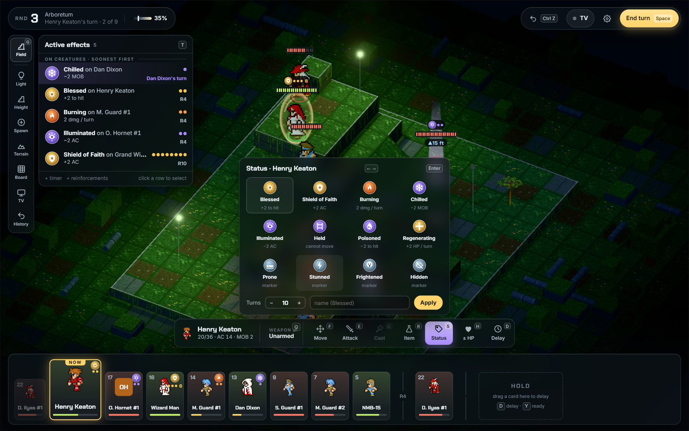 | 12 presets with emblems, a turns stepper and a custom name. |
| Weapon + ammo | 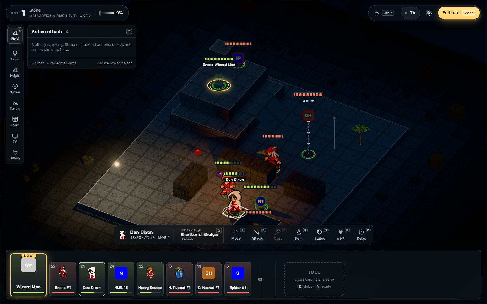 | New in the action bar: the equipped weapon and its ammo count. Click it or press Q to swap. The old sidebar had this. |
| Right-click menu | 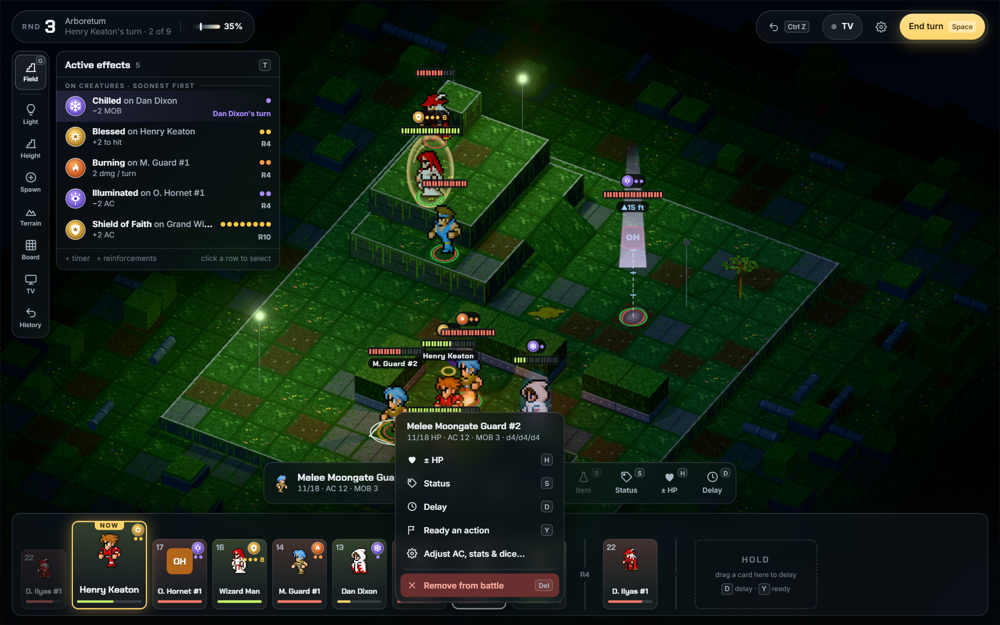 | A header with HP / AC / MOB / damage dice, then ±HP, Status, Delay, Ready an action, Adjust… and Remove (red). Party members also get Pick up. |
| Adjust sheet | 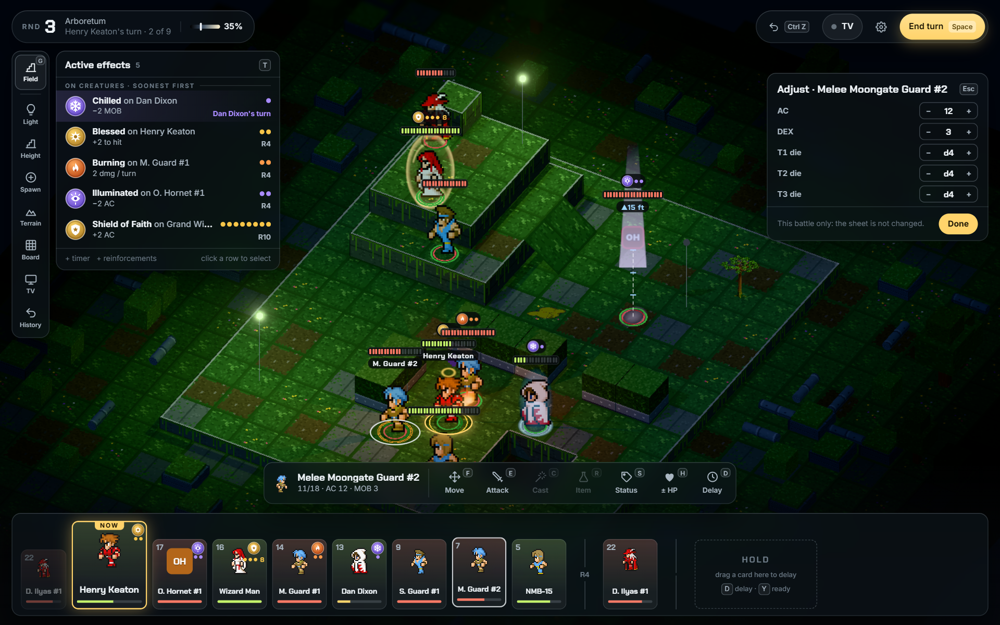 | Battle-only tweaks to AC, stats and the T1–T3 dice; the sheet file is not changed. Raised values show green, lowered values red. |

## Board, setup, TV
| Screen | Shot | What I decided |
|---|---|---|
| Setup | 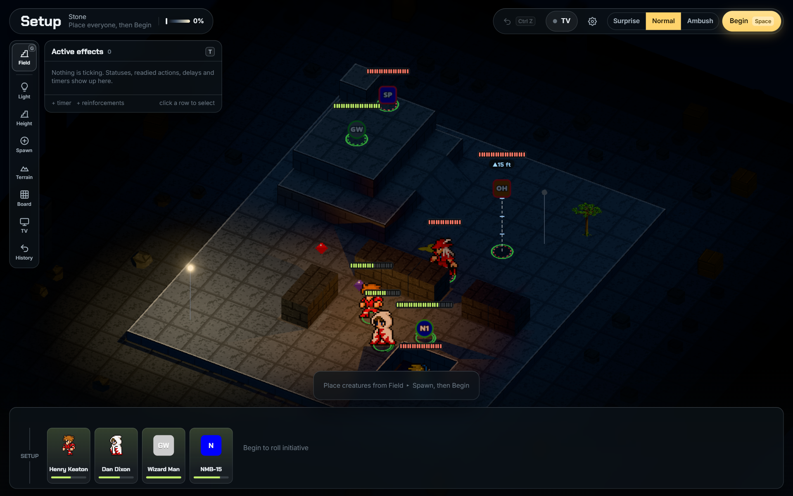 | The round pill says what to place next; Surprise / Normal / Ambush and Begin sit top right. |
| Field ▸ Light | 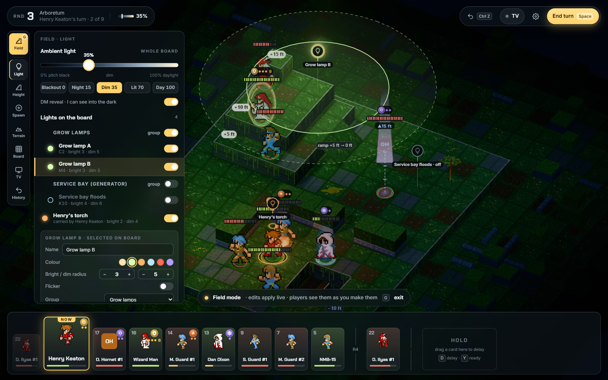 | As designed in the mockups. |
| Field ▸ TV | 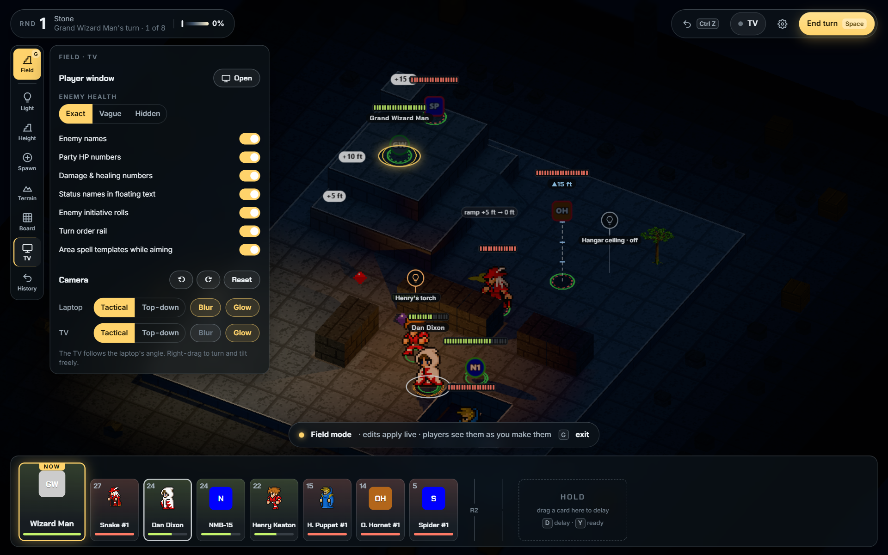 | Player-window options, plus a new **Camera** block: tactical or top-down, blur and glow for the laptop and the TV, turn 90°, and reset. |
| TV during a roll | 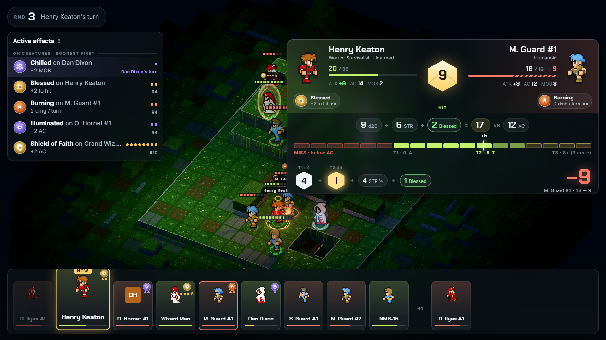 | The roll panel fills in on the TV as you type. |
| TV turn banner | 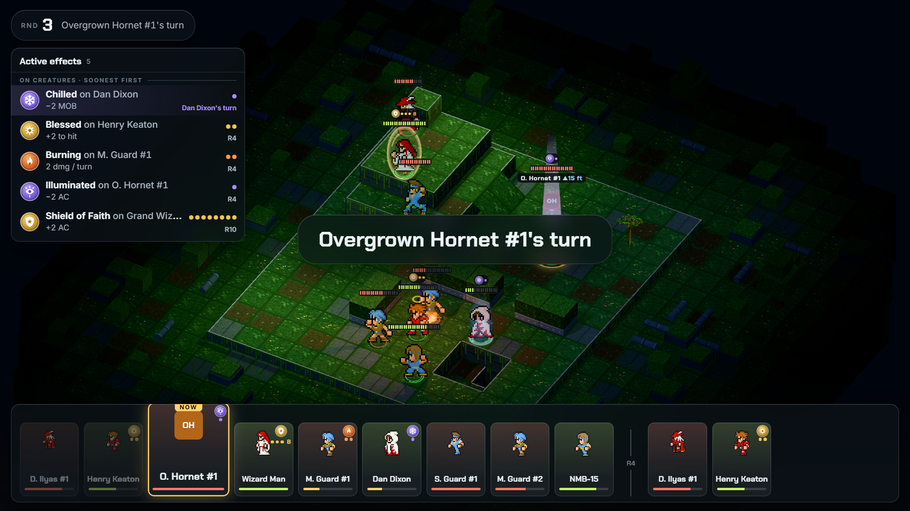 | "<name>'s turn" shows for 2 seconds on every turn change. |

## Built but not captured yet
- **Item sheet (R)**.
- **Dying actions**: Recover, Hold on and Perish replace the action bar for a dying hero.
- **Ready, timer, reinforcement, save and load sheets.**
- **Prompts**: reinforcements due ("Bring them in" / Later / Cancel), and timers, which can switch a light group.
- **TV plate**: a party member the DM selects shows on the TV.
- **Victory**: still the old overlay; not redesigned yet.

## Questions for you
1. Should a tie you dismiss with **Later** really come back every round, or should it be settled for the rest of the battle?
2. Do you want the TV turn banner, and is 2 seconds the right length?
3. Is the weapon chip in the action bar enough, or should the roll panel also show ammo left?
4. Anything to change on the screens above before I move on to the remaining Field tabs (Height, Spawn, Terrain, Board, History)?
