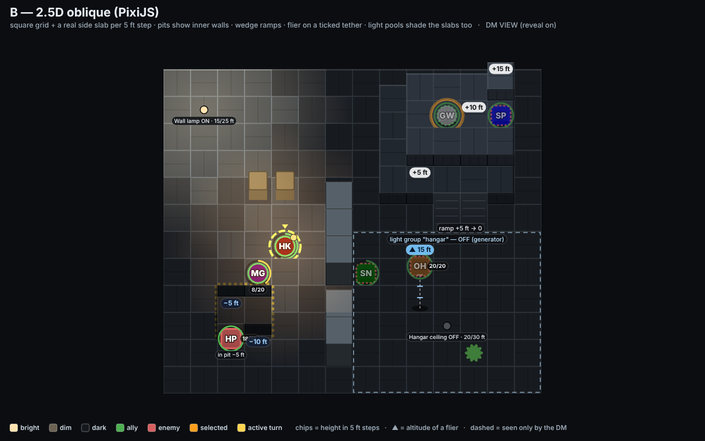
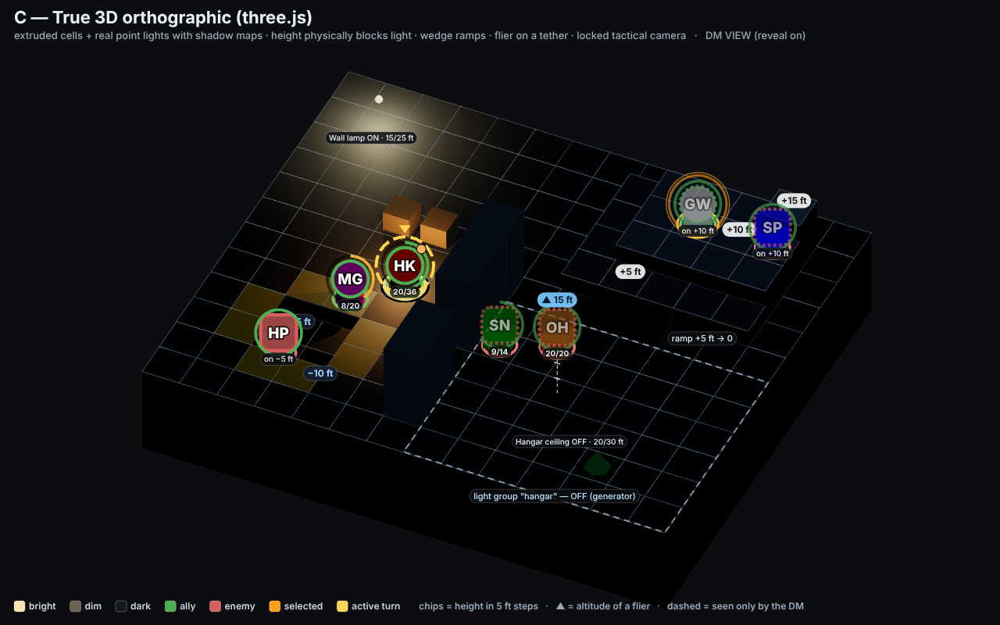
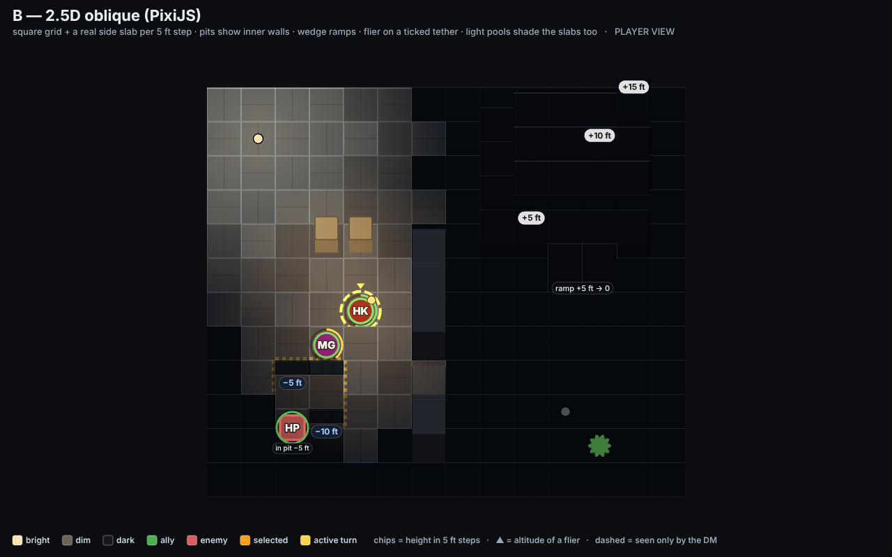
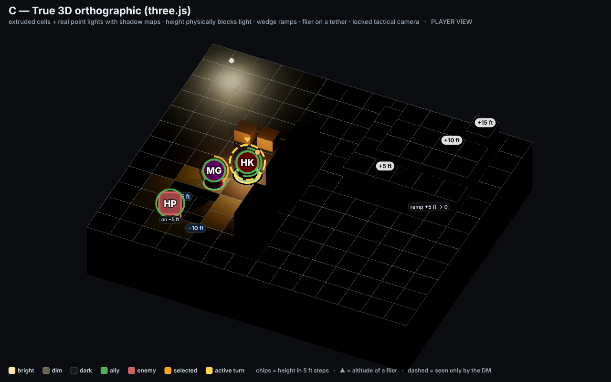

# Phase 3 — Visual direction proposals

Three distinct directions for the board, rendered as **real static mockups of the same test scene** and
screenshotted headlessly with Playwright. Pick one; Phase 4 builds it behind the `BoardRenderer`
interface against the same engine. Combat rules are untouched by any of them; the visual ideas that
*would* need a rule are listed as questions at the end.

| | A — Top-down 2D | B — 2.5D oblique | C — True 3D orthographic |
|---|---|---|---|
| Page | [a-topdown.md](a-topdown.md) | [b-oblique.md](b-oblique.md) | [c-three.md](c-three.md) |
| Library | PixiJS | PixiJS | three.js |
| DM view |  |  |  |
| Player view |  |  |  |

Side by side: [DM views](shots/side-by-side-dm.png) · [player views](shots/side-by-side-player.png).
Live pages (after `npm run dev`): <http://localhost:5173/docs/visual-directions/mockups/>. Regenerate
every PNG with `node scripts/mockup-shots.mjs`.

## The shared test scene (`mockups/scene.js`)

14 × 12 tiles on a worn moonbase deck. Everything the brief asked for is in frame:

- **Raised platform** at +10 ft (top right) with an L-shaped +5 ft ledge, a +15 ft outcrop in its corner
  (three levels touching), a **two-tile ramp** from the ledge down to the floor, and a cliff edge on its west
  side.
- **Pit** at −5 ft (bottom left) with a −10 ft corner and hazard striping on the rim; an enemy stands in it.
- **Bulkhead wall** down the middle with a doorway, blocking movement and light.
- **Two light sources on**: a fixed *wall lamp* (bright 15 ft / dim 25 ft) and a *torch carried by Henry*
  (bright 10 / dim 20) that moves with him. A third, the *hangar ceiling* group, is **off**: the whole
  south-east room is the area in darkness until "the generator is restored".
- **Flying token**: the Overgrown Hornet at 15 ft altitude over the dark hangar.
- Tokens: three party members (Henry active turn, Grand Wizard Man selected on the platform, Magnolia at
  8/20 HP) and four enemies, one on the platform next to the wizard so "on high ground" reads against a
  neighbour at the same height.
- Line of sight for light is computed once, shared by all three (`computeLighting()`): walls block, and
  terrain higher than both the light and the target blocks, so the platform shades the floor behind it.

The DM view has *reveal* on (dark cells drawn dim, tokens in darkness dashed); the player view hides
tokens in darkness and paints dark cells almost black. Light groups are outlined for the DM only.

## What each direction does for the top priorities

### Elevation readability

| Question | A top-down | B oblique | C 3D |
|---|---|---|---|
| Platform vs floor from across the room | lighter alloy per level + stacked contour bands (one band per 5 ft) + NW rim light. Reads as "a lighter shape with a shadow", not as volume. | the platform has a **visible side slab per 5 ft step**; you count steps the way you count stairs. Strongest at-a-glance height cue of the three on a flat screen. | real extruded blocks with cast shadows. Most convincing, but the camera angle hides the north faces so some edges only read from the shadow. |
| Pits | darker tile + hazard rim + bands pointing inward; `−5 ft` chip. Depth is implied. | the pit's inner walls are drawn, the token inside is ghosted through the rim (cut-away rule). | a real hole; the inner walls are lit by whatever light reaches them. |
| Cliffs & ledges | band width grows with the drop; hard cliff line | slab height grows with the drop | geometry |
| Stairs & ramps | gradient fill + downhill chevrons | wedge tile with treads | wedge geometry (treads/stairs trivial to add) |
| Multiple levels side by side | three greys + three chips | three slab heights visible at the +15/+10/+5 corner | geometry |
| Exact heights without clutter | **one chip per plateau** (not per tile), tokens standing off the floor get an `on +10 ft` tag | same chips; slab bands double as a ruler | same chips, projected into the view |
| On high ground vs flying | flier is lifted toward the camera, shadow stays on its tile, dashed tether, `▲ 15 ft` chip in sky-blue | flier floats above its shadow on a **ticked tether** (one tick per 5 ft); ground token on a platform sits on the slab | same tether in 3D plus a shadow decal; the hornet visibly hangs in space |
| Occlusion risk | none | a tall column hides the row behind it; handled by drawing rows back-to-front, ghosting units in pits, and (Phase 4) a hover cut-away for anything behind a 3-step wall | highest: 3D walls and platforms hide tiles. Mitigation: locked angle, top-down toggle, ghosting through walls when a unit is behind them |
| Hit-testing | exact | exact per cell (the old Java bug of clicks ignoring lift is fixed by hit-testing the lifted top faces, row-front first) | ray-pick against the cell meshes |

### Lighting

All three use the same model: per-light **bright/dim radii in 5 ft steps**, light attached to a token or
placed on a tile, on/off, **light groups** (the hangar) toggled at once, D&D levels **bright / dim /
darkness** per cell, and DM reveal. They differ in how it looks:

- **A** / **B**: per-cell darkness mask + additive radial light pools clipped to the cells the light
  actually reaches (so walls and higher terrain cast hard shadows). In Pixi this is one mesh with a
  fragment shader: smooth falloff, coloured lights, dozens of lights at 60 fps on a 25×25 board. Group
  transitions tween the mask over ~600 ms (lights flicker on, darkness peels back). B also shades the
  slabs, so a lit platform face next to a dark one reads instantly.
- **C**: real point lights with **shadow maps**; height blocks light because it physically does. Light on
  the top of a platform and shadow underneath its lip come for free. Transitions are trivial (tween
  intensity). Cost: each shadow-casting point light is six depth renders per frame; past ~8 shadowed
  lights you need to budget (static-light shadow caching, which three.js supports).

Player vs DM: identical in all three — tokens in darkness are hidden from players and dashed for the
DM; dark cells are near-black for players and dim for the DM when reveal is on. (Whether players should
also lose the *geometry* of dark areas is a display option, not a rule.)

### Board and tokens (shared design, all three)

- **Moonbase facility** tiles first: dark steel plating with seams and rivets, alloy getting lighter one
  step at a time as you go up (so height is also a colour ramp), hazard stripes on drops, bulkhead walls.
  The **arboretum dome** style swaps the plate texture for soil/grate panels, the hazard yellow for moss
  green, and adds walkable ferns that draw over feet. Each style is a texture set + palette; the renderer
  does not change.
- Tokens: **big** (72 % of a tile), initials in heavy white type with a dark outline, party = circle,
  enemy = rounded square, side colour ring (green / red), character colour fill, **HP arc** around the
  ring in green/amber/red, optional HP numbers (a player-display option), **orange double ring =
  selected**, **gold dashed ring + pennant = active turn**. All of that is drawn in 2D even in direction
  C (billboarded over the 3D body) so it stays crisp on a TV.
- Gridlines are light and always on; the board is sized to **fill the viewport** with a thin margin and a
  legend strip, no floating card in a void.

## Recommendation

**B — 2.5D oblique with PixiJS.** It is the only option where height is visible as *shape* without giving
up the exact square grid the rules run on, it costs about the same as A to build, and its one real risk
(occlusion behind tall things) is contained by rules we already prototyped (back-to-front rows, ghosted
pit units, hover cut-away). A is the safest and quickest but height never stops being "a lighter square
with a shadow"; C has the best lighting and the strongest "wow", at the price of a camera your players
have to learn to read, ray-picking, shadow-map budgets, and a renderer that is harder to keep smooth on a
25×25 board with 40 tokens and 20 lights.

If you want C's real shadows, the engine state is identical, so switching renderer later is possible,
but the token/HUD layer would need to be rebuilt as billboards and the camera UX designed properly.

## Questions that would need a rule change (not done; your call)

1. Should a 5 ft step cost extra movement to climb, and should ramps be free? (Today elevation has no
   movement effect at all.)
2. Should being on higher ground or flying change anything mechanical — range, who can be targeted by
   melee, cover? (Today: nothing.)
3. Should darkness affect targeting (attacks or spells into a dark cell), or stay visual-only (what the
   players see)? The proposals assume **visual-only**.
4. Should walls block attacks, spell areas and movement *paths*, or keep today's "collision blocks
   standing only" and treat light-blocking as a separate, visual-only flag on terrain? The mockups
   assume **visual-only**.
5. Falling into a pit, or a flier being knocked down: any damage or forced movement? (Today: no concept.)
6. Flying: free altitude in 5 ft steps set by the DM, no movement cost for climbing? (That is what the
   mockups assume.)
