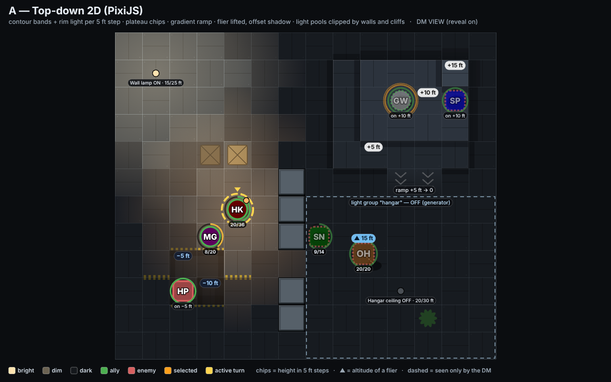
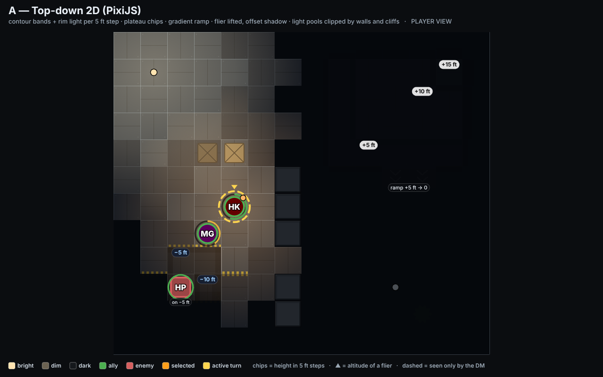

# Direction A — Top-down 2D (PixiJS)

Live: `mockups/a-topdown.html` (`?view=player`). Straight top-down, no tilt. The camera is the one the
current Java board uses, so every existing interaction (click = tile) carries over unchanged.

## Elevation

- **Levels as material**: floor alloy gets lighter per 5 ft step (ground → +5 → +10 → +15) and pits get
  darker and bluer, so a plateau reads as a lighter shape from across the room.
- **Contour bands**: on every edge where the neighbour is lower, a dark band falls onto the lower tile,
  one sub-band per 5 ft of drop (so a 10 ft cliff shows two bands), with a bright rim on the high side as
  if lit from the north-west, and a hard black cliff line. This is the classic "map contour" read.
- **Pits**: the same bands pointing inward, hazard striping on the rim, inverted (blue-on-dark) height chip.
- **Ramps / stairs**: gradient from the upper to the lower level with downhill chevrons; stairs would be
  the same tile with treads instead of a gradient.
- **Exact heights**: one chip per connected plateau (`+10 ft`, `−5 ft`), placed on a free tile; a token
  standing off the floor gets an `on +10 ft` tag under it. Nothing is written on every tile.
- **High ground vs flying**: a token on a platform sits flat on the lighter tile with its tag. A flier is
  drawn **offset toward the camera** (up-left, 7 px per 5 ft), its ground shadow stays on the tile, a dashed
  tether joins them, and a sky-blue `▲ 15 ft` chip sits above it. The three cues together are what stop
  "flying" and "standing on a platform" from looking the same.
- **Honest trade-off**: height is *inferred* from shading and labels; it never looks like volume. For a
  big multi-level map the DM will lean on the chips. On the other hand nothing is ever hidden, hit-testing
  is exact, and the player screen on a TV is as legible as a printed battle map.

## Lighting

- Per-cell level (bright / dim / dark) from each light's radii and line of sight; walls and terrain higher
  than both the light and the target block it (the platform throws a shadow across the floor behind it).
- Rendered as a darkness mask over the board plus additive, light-coloured pools clipped to the cells the
  light reaches, so shadows have hard edges that match the grid. In Pixi this is a single full-board
  shader pass: smooth falloff, any number of lights, cheap.
- Sources: fixed tile (wall lamp), attached to a token (Henry's torch moves with him), on/off, radii in
  5 ft steps. **Groups** (the hangar) switch together; the transition is a 600 ms tween of the mask plus a
  brief flicker on the pool.
- Player vs DM: player view paints dark cells near-black and hides tokens in them; DM reveal keeps dark
  cells readable and draws hidden tokens dashed. Light sources show name/radii chips for the DM only.

## Board and tokens

Facility plating with seams and rivets; arboretum swaps texture/palette only. Tokens 72 % of a tile,
initials, side ring, HP arc, selected/active rings as described in the README. Board fills the viewport.

## Library and performance

PixiJS 8 (WebGL/WebGPU, 2D scene graph, filters). Tiles are one tilemap mesh; lights one shader; tokens
sprites. A 25×25 board with 40 tokens and 20 lights is well under 2 ms per frame. Cheapest direction to
build and to keep smooth.
